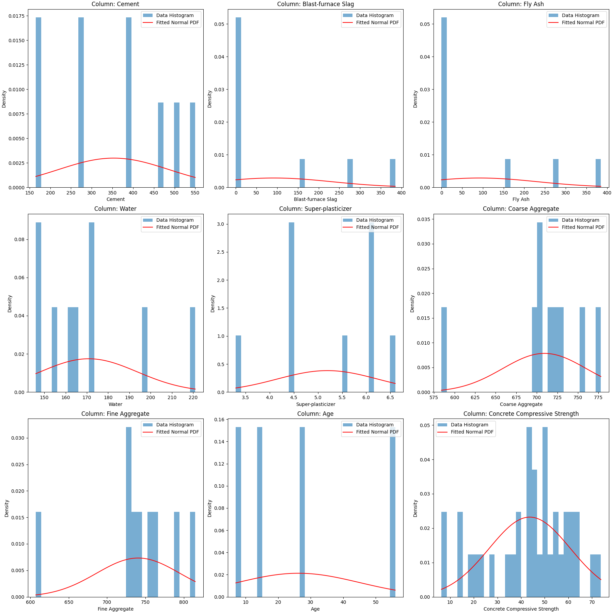
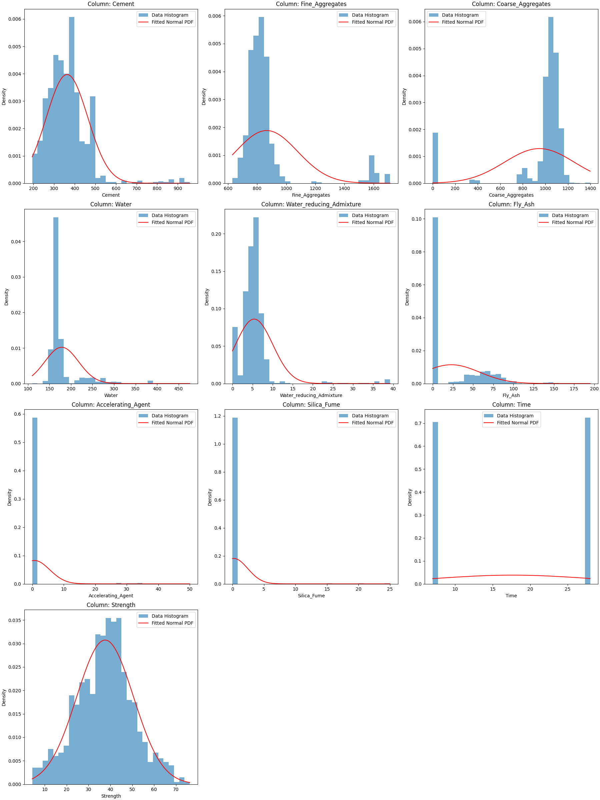
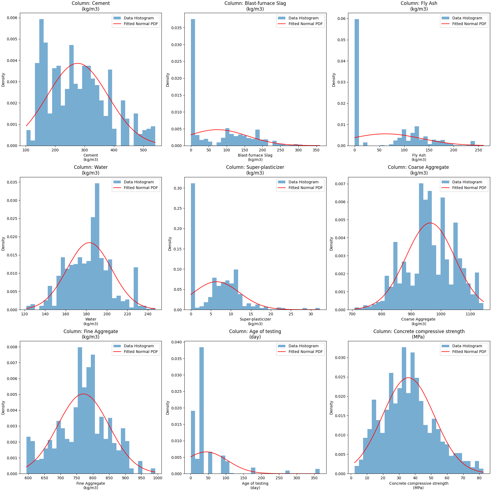
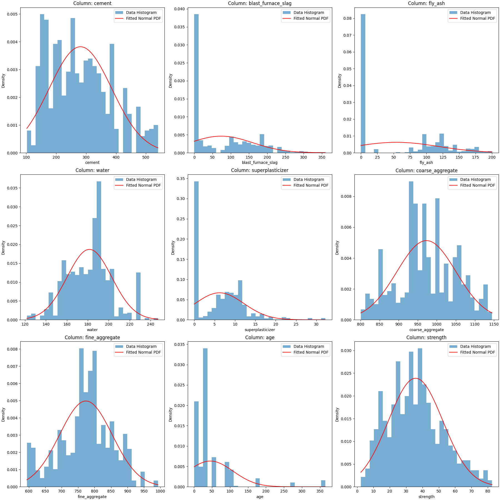
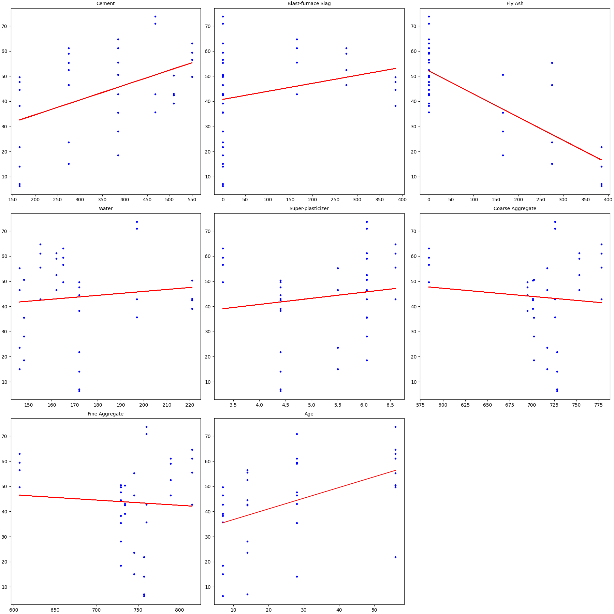
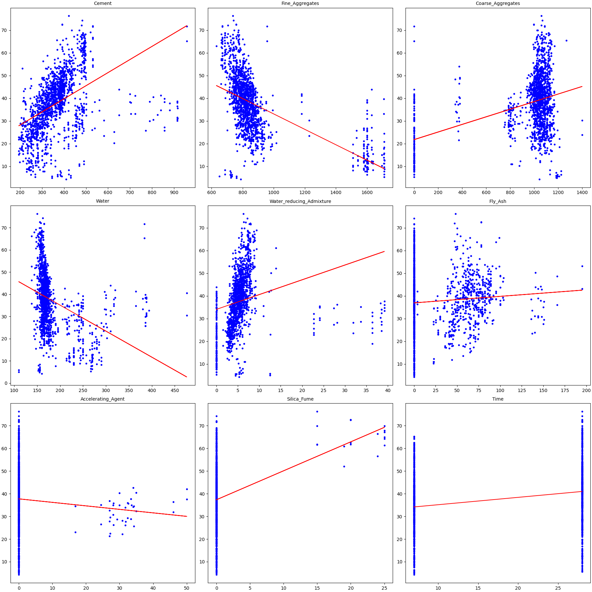
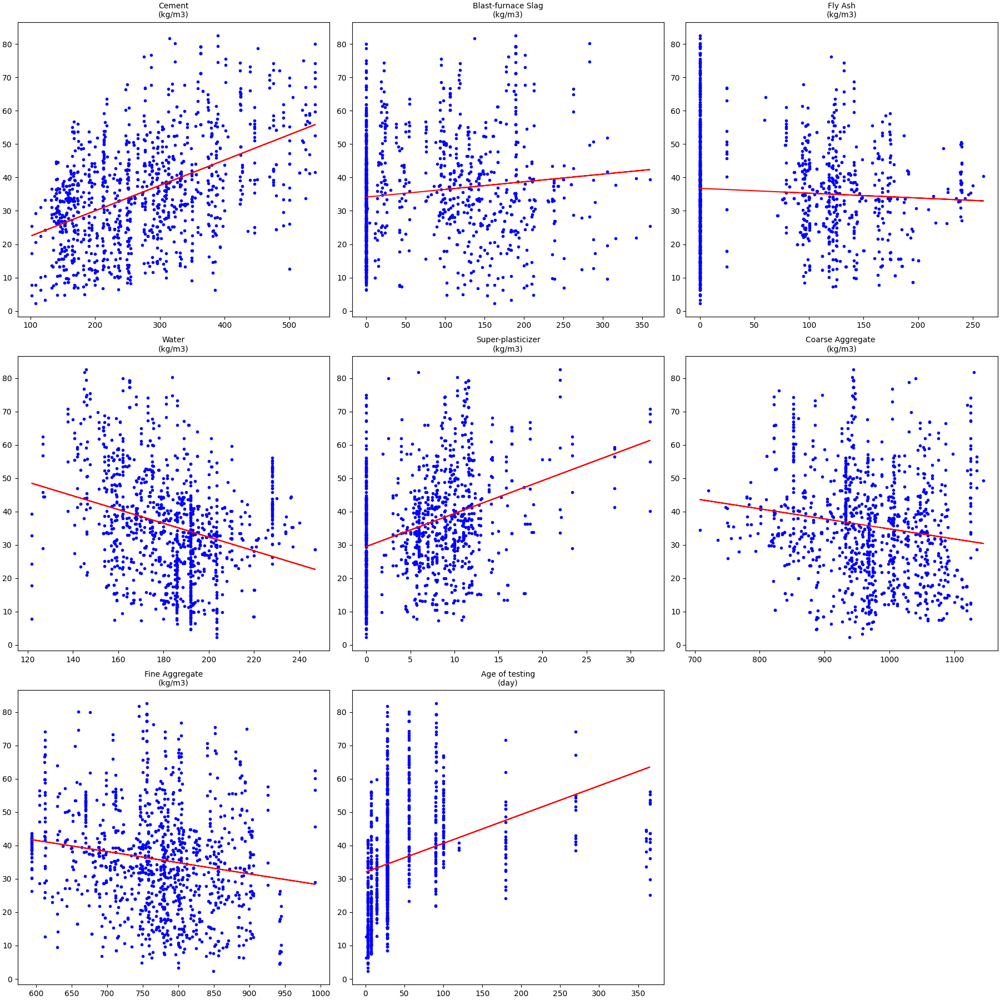
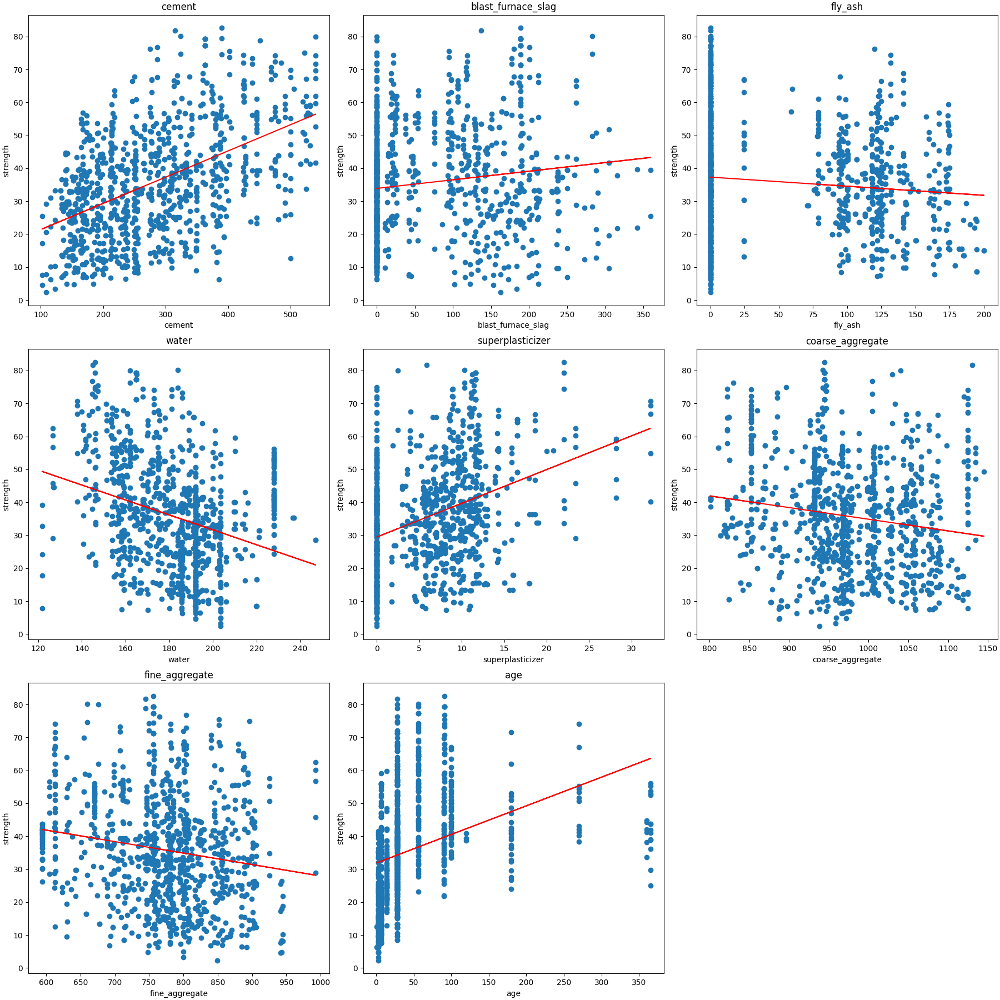

# Concrete Strength Predictor

## Goal

Build a concrete strength predictor that uses data from tests to inform what a strength would be based on ingredient amounts.

The goal for the project was initially to see which ingredient in concrete influences the strength the most.
After meeting with my professor for the course (Applied Probability & Statistics), they recommended that I pursue a probability
based project instead of a statistical one.
Predicting the stregth was discussed and that then became the goal of the project.

## How it was done / Structure

Four concrete compressive strength data sets were sourced online and are used as training data for the predictions.
  These are toggled between becasue each .csv file has a different schema

main.py
  Reads in data set selected
  Creates x-axis and y-axis for Diagnostics Plot
  Main runner is the main entry point for the program.
    It converts the data set into a data frame,
    this data frame is then sent to ThetaFinder in utilsProbs.py,
    the thetas and ingredient quantity inputs are then sent to Predict in utilsProbs.py,
    Predict returns y_pred and it is printed to the terminal.

utilsProbs.py
  This utility file mostly contains functions supporting the ThetaFinder function (θ = (((X^T)*X)^-1)*(X^T)*(~>y)):
    MatrixCreator     retruns: matrix
    MatrixDummyColumn returns: finalMatrix
    MatrixMultiplier  returns: result
    MatrixTranspose   returns: transposedMatrix
    MatrixInverse     returns: inversedMatrix
    TargetVector      returns: y
    ThetaFinder       returns: theta, epsilon, y_hat
    Predict           returns: y_pred

utilsStats.py
  The utility stats file is comprized of functions that are needed inside of Plotting.py:
    Mean              returns: mean
    StandardDeviation returns: standard_deviation
    Correlation       returns: correlation
    RegressionLine    returns: result
    Covariance        returns: covariance
    Distribution      returns: mu, sigma

plotting.py
  There are only three functions used for plotting/graphs:
    LinearRegression_AllColumns -> plots regression line for each ingredient (x) against respective stregth (y)
    DistributionPlot -> plots a histogram and probability density function overlay for each the ingredients
    PlotDiagnostics -> shows 3 subplots: predicted vs actual, residuals vs prediction, error magnitude plot

## Figures

<!-- Add background colours -->

<h4 align = "Center"> Data Set Distributions <h4>

<table border="0" align="center">
  <tr>
    <td></td>
    <td></td>
  </tr>
  <tr>
    <td></td>
    <td></td>
  </tr>
</table>

<h4 align = "Center"> Data Set Linear Regression <h4>

<table border="0" align="center">
  <tr>
    <td></td>
    <td></td>
  </tr>
  <tr>
    <td></td>
    <td></td>
  </tr>
</table>

<h4 align = "Center"> Strength Prediction Diagnostics <h4>

<table border="0" align="center">
  <tr>
    <td align="center">
      
      <h6> line 6: 385,165,0,155,6.6,778,815,7, y = 42.83 <h6>
    </td>
    <td align="center">
      
    </td>
  </tr>
  
  <tr>
    <td align="center">
      
      <h6> line 61: 148.1,0,136.6,158.1,16.1,1001.8,830.1,28, y = 17.96 <h6>
    </td>
    <td align="center">
      
    </td>
  </tr>

  <tr>
    <td align="center">
      
      <h6> line 13  198.6,132.4,0,192,0,978.4,825.5,28, y = 28.021683592 <h6>
    </td>
    <td align="center">
      
    </td>
  </tr>
</table>

